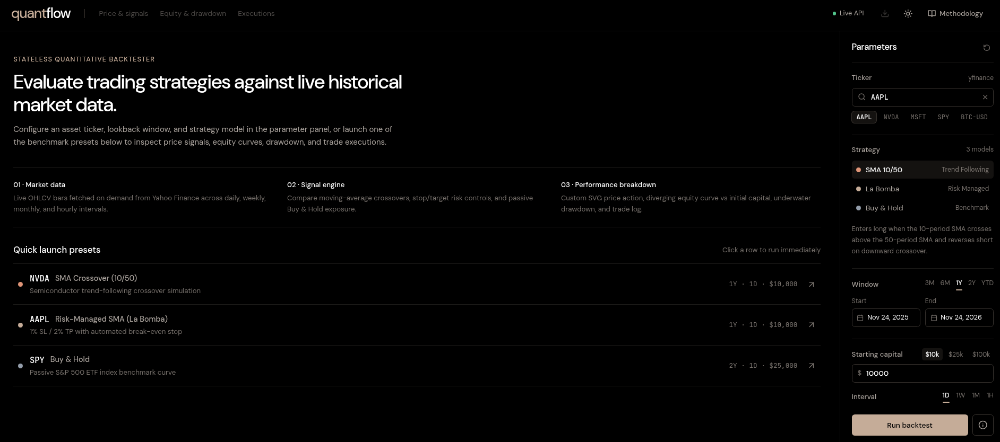
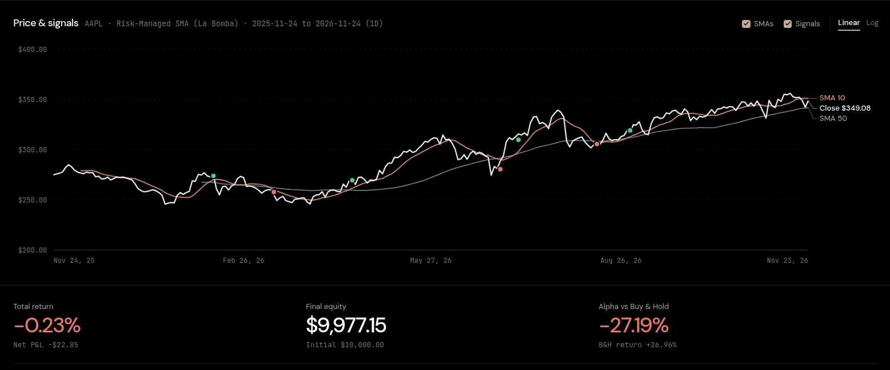
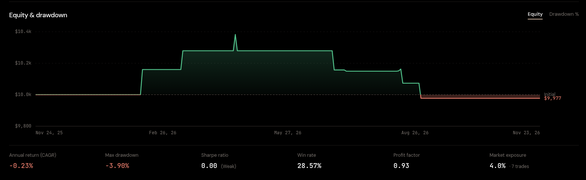
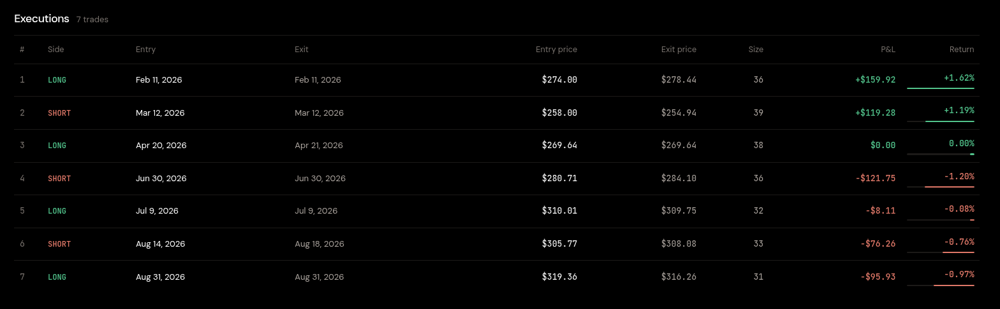

# QuantFlow Equity Strategy Backtester Demo



A full-stack quantitative backtesting application combining a stateless Django REST API (`yfinance` + `backtesting.py`) with a React/TypeScript frontend featuring custom `<svg>` financial visualizations.

## Quick Start (Run Locally with Live Django Backend)

### Prerequisites

- Python 3.11+ and [`uv`](https://docs.astral.sh/uv/)
- Node.js 20+ (Node 22 recommended) and `npm`

### Option 1: Local Dev Servers (2 Terminals)

1. **Clone the repository**:

```bash
git clone https://github.com/Sabellaj05/backtest-dj.git
cd backtest-dj
```

2. **Start the Django backend** (Terminal 1):

```bash
cd django-backend
uv sync
uv run python manage.py runserver 8000
```

3. **Start the Vite frontend** (Terminal 2):

```bash
cd django-front
npm install
npm run dev
```

4. Open `http://localhost:3001` in your browser. The header badge will show `Live API` and simulations will pull live Yahoo Finance data.

### Option 2: Docker Compose

```bash
git clone https://github.com/Sabellaj05/backtest-dj.git
cd backtest-dj
cp .env.example .env
docker compose up --build
```

Open `http://localhost` (Nginx serves the built frontend and proxies `/api/` to Gunicorn on port 8000; no database or migrations are required).

## Implemented Strategies

- **SMA Crossover (10/50)** (`sma_cross`): Trend-following crossover entering long when SMA(10) crosses above SMA(50) and reversing short on downward crossover.
- **Risk-Managed SMA (La Bomba)** (`la_bomba`): SMA 10/50 crossover with a 1% Stop Loss, 2% Take Profit, and automatic Break-Even stop adjustment once unrealized profit reaches +1%.
- **Buy & Hold** (`buy_and_hold`): Passive benchmark allocating starting capital on bar 1 through the end of the selected window.

## API Endpoints

- `GET /api/v1/healthcheck/` — Readiness check (`{"status": "ok"}`).
- `GET /api/v1/strategies/` — Strategy catalog metadata.
- `POST /api/v1/backtest/` — Executes a stateless backtest (`ticker`, `startDate`, `endDate`, `strategy`, `capital`, `interval`) and returns `meta`, `metrics`, `price_chart`, `equity_chart`, and `trades`.

## Charts

### Price & Signals



### Equity & Drawdown



### Executions


